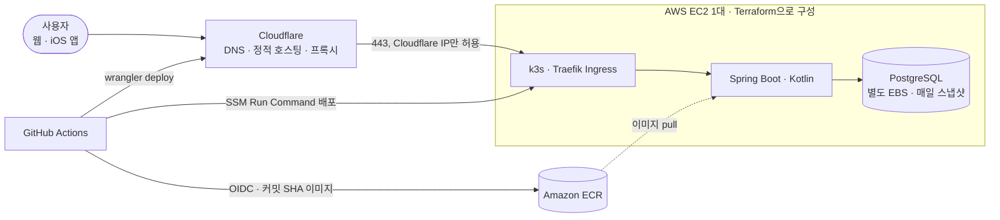

<!--
  프로필 레포(seonghong1/seonghong1)의 README.md에 그대로 붙여 넣는다. 한국어판. 2026-11-23 작성, 같은 날 담백하게 다시 씀.
  이력서처럼 경력을 나열하지 않고, 개발 · 사이드 프로젝트(개연시) · 기술 스택만 담는다.
  꾸밈은 기술 스택 배지에만 쓴다. 애니메이션 헤더 · 타이핑 문구 · 통계 카드 · 이모지는 쓰지 않는다 (본인 요청).
  근거: ../사이드_프로젝트/gaeyeonsi/프로젝트_정리.md (8-1 · 8-2 · 8-3 · 8-4 · 8-6 · 8-14 · 9장),
        gaeyeonsi 레포 documents/development/cicd/01-github-actions.md (OIDC, 커밋 SHA 태그, SSM Run Command)
  쓰지 않은 숫자: 에피소드 수 · 테스트 수(계속 바뀜), 월 운영비(추정치), 사용자 · 다운로드 수(근거 없음)
-->

### 안녕하세요, 백엔드 개발자 조성홍입니다.

지금은 외국어 교육 플랫폼에서 수업, 예약, B2B 서비스를 만들고 있고, 개인적으로는 Kubernetes와 Terraform으로 사이드 프로젝트를 운영하고 있습니다.

 

## 기술 스택

| 분야 | 기술 |
|:---:|:---|
| **Backend** |       |
| **Database** |    |
| **Infra · DevOps** |        |
| **Frontend · App** |     |
| **AI** |   |

 

## 개연시

장애 대응 시뮬레이션 게임 · [gaeyeonsi.com](https://gaeyeonsi.com) · [App Store](https://apps.apple.com/kr/app/id6832839828)

장애 알림이 울리면 로그와 지표에서 단서를 찾고, 대응을 골라 서비스를 복구하는 게임입니다. Kubernetes와 Terraform을 직접 운영해 보려고 시작했고, 기획부터 웹과 iOS 출시, 운영까지 혼자 하고 있습니다.

Kotlin · Spring Boot · PostgreSQL · React · Capacitor · k3s · Terraform · AWS · Cloudflare

- 시나리오를 DB 테이블과 1:1인 JSON으로 두고 엔진은 해석만 합니다. 에피소드를 늘려도 엔진 코드는 그대로입니다.
- 모든 선택 경로를 끝까지 플레이하는 검증기가 PR CI에서 돌아, 막다른 길이나 도달할 수 없는 엔딩이 있으면 병합을 막습니다.
- EKS, RDS, ALB, NAT 없이 EC2 1대에 k3s와 PostgreSQL을 두고, DB 데이터만 별도 EBS와 매일 스냅샷으로 지킵니다. 표준 Ingress와 ConfigMap만 써서 EKS로 옮길 수 있게 했습니다.
- GitHub Actions는 OIDC로 AWS에 인증하고, 커밋 SHA 태그 이미지를 SSM Run Command로 배포합니다. 서버에 SSH 포트는 열지 않습니다.
- Access token은 15분 동안 메모리에만 두고, Refresh Token Rotation에서 이미 쓴 토큰이 다시 오면 그 계열을 모두 무효화합니다.
- 채점식을 바꿀 때 배포와 전환을 설정값으로 나누고, 드라이런으로 영향을 본 뒤 끝난 판 286개를 다시 채점했습니다. 포인트가 줄어든 회원은 0명입니다.

Claude Code와 함께 개발합니다. 결정은 버린 안과 받아들인 대가까지 문서에 먼저 쓰고, 구현은 에이전트에 맡기되 검증은 검증기와 테스트, CI로 합니다.

 

## 요즘 관심 있는 것

- Kubernetes와 Terraform: k3s로 시작한 개연시를 EKS로 옮기는 절차를 공부하고 있습니다.
- AI 에이전트로 테스트하기: 단계마다 에이전트를 나누고, 테스트는 에이전트가 실제 브라우저를 조작해 확인하게 합니다.
- 서비스 보안: 런타임과 서버 취약점 소식을 찾아보고, 운영 중인 서버에 영향이 있는지 직접 확인합니다.

 

## 연락처

[Email](mailto:seonghong_jo-dev@naver.com) · [LinkedIn](https://www.linkedin.com/in/seonghong-jo-ba611a306) · [개연시](https://gaeyeonsi.com)
